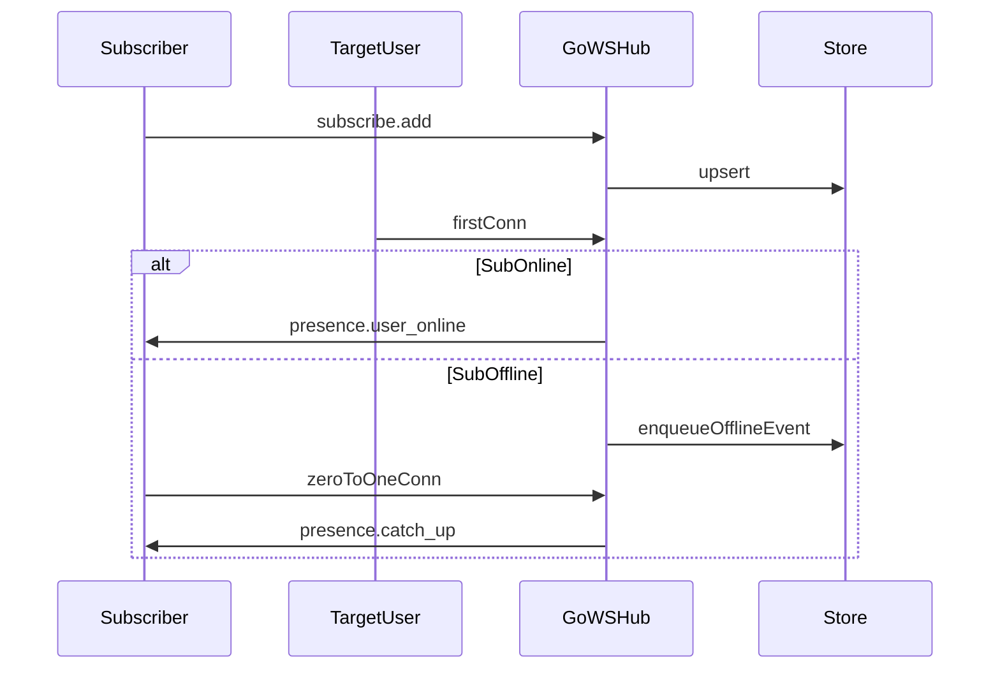
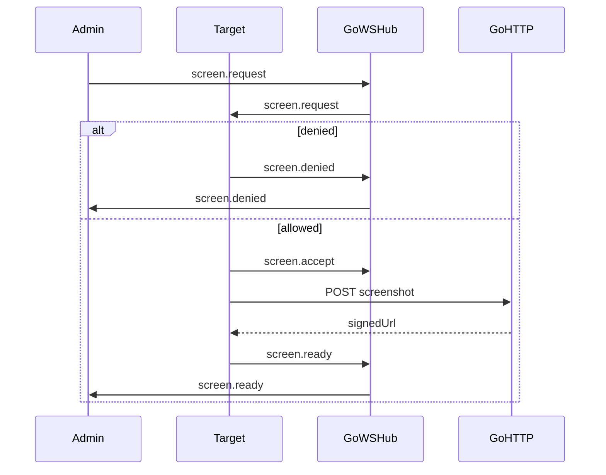

# WebSocket 方案（Go + 前端）

给前后端实现用的契约。双方同时做时以本文为准，不要另起一套事件名或再走 Socket.IO。

- 前端仓库现状：`src/utils/ws.ts` 使用 socket.io-client 连接 Nest `/nestws`。
- Go 现状：`GET /gows?token=`，权限 `ws:connect`（见 `api.md` §6）。
- 选型：原生 WebSocket。截屏禁止经 WS 传 blob，改为确认后 HTTP 上传，再用短时签名 URL 回显。
- 部署：Hub 为单进程内存。在线索引、房间、截屏转发都不跨实例。多副本 / Redis 不在本期。

## 分工

| 侧   | 做这些                                                                                                      | 不要做       |
| ---- | ----------------------------------------------------------------------------------------------------------- | ------------ |
| Go   | Hub、信封、房间、订阅表、离线补推、截屏状态机、签名 URL、强制下线吊销会话、审计、更新 API 文档              | 不改前端页面 |
| 前端 | 重写 `src/utils/ws.ts`、连接态、refresh 重连、Header 截屏确认、WebsocketAdmin、通知、订阅页、去掉 socket.io | 不改 Go 路由 |

建议顺序：Go 先打通 `welcome` / `ping` / `presence`，前端即可联调；截屏和订阅可并行。

## 时序





## 1. 连接与身份

| 项     | 约定                                                                                        |
| ------ | ------------------------------------------------------------------------------------------- |
| URL    | `ws://{host}/gows?token={access_jwt}`。浏览器只能放 query；升级前 Bearer 仅给非浏览器客户端 |
| 权限   | `ws:connect` 连接和订阅；`ws:admin` 监控、截屏、强制下线；`ws:notify` 发全站通知            |
| 身份   | JWT 的 `user_id` 为雪花字符串。每条连接一个 `conn_id`（UUID）                               |
| 多标签 | 截屏按 `conn_id`。上线/下线按 user：连接数 0 到 1、以及回到 0，各只推一次                   |

连接成功后服务端立刻发送：

```json
{
  "v": 1,
  "type": "welcome",
  "payload": {
    "conn_id": "c_xxx",
    "user_id": "123456789",
    "server_time": 1730000000
  }
}
```

心跳：客户端每 30 秒发送 `ping`，服务端回 `pong`。任意客户端帧（含 `ping`）都重置空闲计时。连续 90 秒没有客户端帧则断开。

### 1.1 Token 过期

校验失败或 access 过期时，服务端先发再关连接：

```json
{
  "v": 1,
  "type": "auth.expired",
  "payload": { "code": 40104, "message": "token expired" }
}
```

前端收到 `auth.expired`，或非主动关闭，复用现有 axios refresh（不要并行再刷一次 token），然后用新 token 重连。重连后恢复曾经加入的房间（例如还停在监控页就重新 `room.join admin-watch`），并发送 `subscribe.list`。离线补推只在该用户连接数从 0 变为 1 时发一次，不是每个 `welcome` 都发。

### 1.2 连接状态（仅前端）

`webSocketManager.status`：`idle | connecting | connected | reconnecting | offline`。状态变化时分发：

```json
{ "type": "connection.status", "payload": { "status": "reconnecting", "attempt": 2 } }
```

Header 只做轻提示，重连时不挡住业务页。

## 2. 信封

所有帧都是 UTF-8 JSON：

```json
{
  "v": 1,
  "type": "string",
  "request_id": "可选",
  "payload": {}
}
```

错误帧：`type` 为 `error`，`payload` 为 `{ "code": 40301, "message": "forbidden" }`。业务码沿用 goadmin。

前端 `postMessage({ type, data })` 可保留。内部把 `data` 写成 `payload`，并带上 `v: 1`。`MySocketID` 保存 `welcome.conn_id`。

## 3. 房间

内存索引：

- `conn_id -> Conn`
- `user_id -> conn_id 集合`
- `room -> conn_id 集合`
- `target_user_id -> subscriber_user_id 集合`（与订阅表同步）

| room          | 加入                                 | 用途     |
| ------------- | ------------------------------------ | -------- |
| `online`      | 连接成功自动加入                     | 在线索引 |
| `admin-watch` | 持有 `ws:admin` 后客户端 `room.join` | 在线列表 |
| `notify`      | 自动加入                             | 运营通知 |

客户端发送 `room.join` / `room.leave`，`payload.room`。服务端校验权限后再加入。订阅不是房间。

## 4. 事件

### 4.1 在线列表（管理员）

- 上行 `presence.list`（需要 `ws:admin`）
- 下行 `presence.snapshot`、`presence.changed`（只推 `admin-watch`）

```json
{
  "type": "presence.snapshot",
  "payload": {
    "total": 3,
    "users": [
      {
        "user_id": "1",
        "conn_id": "c_a",
        "username": "alice",
        "login": true,
        "connected_at": 1730000000
      }
    ]
  }
}
```

`presence.changed`：`{ "reason": "join|leave|force_offline", "total": 1, "user": {} }`。

前端监控页进入时 join，拉一次 list，然后只听变更。去掉现有 5 秒轮询。`presence.changed` 只给监控页用。全局提示只听 `presence.user_online` / `presence.user_offline`，避免管理员看到两条重复提醒。

### 4.2 通知

- 上行 `notify.push`（需要 `ws:notify`）：`{ title, content, level?, target_user_ids? }`
- 无 `target_user_ids` 时广播 `notify` 房间，有则只推这些用户的全部连接
- 下行 `notify.message`：原字段加上 `from_user_id`、`created_at`
- 限制：title 不超过 100，content 不超过 2000
- 前端全局用 Ant Design notification 展示。公告发送改为这条信令

### 4.3 强制下线

按用户下线，不按单个标签。只断一条连接时，其它标签会用未吊销的 token 立刻重连。

- 上行 `admin.force_offline`：`{ target_user_id }`（需要 `ws:admin`）
- 目标是自己：`40001`
- 吊销该用户全部会话：撤销 refresh，并把当前 access 列入吊销（用现有登出/吊销，不新做一套）
- 向该用户每个连接发送 `admin.force_offline`，payload 为 `{}`，然后关闭连接
- 前端收到后 logout。其它标签再连会得到 `auth.expired` 或 401
- 连接数归零后发一次 `presence.user_offline`，`reason` 为 `force_offline`，并向 `admin-watch` 发 `presence.changed`
- 写审计

### 4.4 截屏

确认在服务端状态机上，不能只靠前端弹窗。

同一 `target_conn_id` 同时只能有一个 `pending` 或 `accepted`。第二个 `screen.request` 返回：

```json
{ "v": 1, "type": "error", "payload": { "code": 40901, "message": "screen busy" } }
```

该请求结束后，同一管理员对同一目标还有 10 秒间隔。状态：`pending -> accepted -> ready`，或者 `denied | timeout | error`。

1. 管理员发送 `screen.request`：`{ target_conn_id, request_id }`。
2. 服务端检查权限、目标连接、没有进行中的请求，记下 `pending` 并开始 30 秒计时。转发给目标：`{ request_id, from_conn_id, from_user_id, from_username }`。
3. 目标弹窗确认。
   - 拒绝：`screen.denied` `{ request_id }`。仅 `pending` 可变为 `denied`，只回给发起这条请求的连接。
   - 同意：`screen.accept` `{ request_id }`。仅目标自己的连接、且状态为 `pending` 时变为 `accepted`。
   - 30 秒仍是 `pending`：改为超时，双方收到 `screen.error` `{ request_id, message: "timeout" }`。之后 accept 和上传都无效。
4. 只有 `accepted` 之后才截屏。先关掉确认框再 `modern-screenshot`。JPEG quality 0.7，最长边 1920。
5. `POST /api/ws/screenshots`，Bearer，权限 `ws:connect`。`multipart` 字段 `file`、`request_id`。文件不超过 2MB，仅 JPEG。请求必须属于当前用户、状态为 `accepted` 且未过期，否则 `40301` 或 `40901`。响应 `{ url, expires_at }`。`url` 为 HMAC 签名，5 分钟有效，例如 `/api/ws/screenshots/{id}?exp=...&sig=...`。下载不看 Cookie，过期 403。
6. 目标发送 `screen.ready`：`{ request_id, url, expires_at, width, height }`。服务端确认已经上传成功后改为 `ready`。
7. `screen.ready` 只发给发起这条 `screen.request` 的连接。图片不进 `admin-watch`，目标本人和其它在线用户都收不到。超时或断开的 `screen.error` 发给发起连接，并同时发给目标连接，用来关掉确认框。
8. 其它失败为 `screen.error`，状态 `error`，释放进行中名额。

文件放在 `storage/screenshots/`，磁盘保留 10 分钟（比 URL 的 5 分钟长，只为了刚传完能打开）。审计记录 request、accept、denied、ready、timeout。

前端 Header：`screen.request` -> 确认 -> `screen.accept` -> 关框 -> 截屏上传 -> `screen.ready`。监控页用签名 URL 显示图片，并处理 denied、error、busy。

### 4.5 订阅、免打扰、离线补推

表 `ws_user_subscription`：

| 列                      | 说明                                     |
| ----------------------- | ---------------------------------------- |
| subscriber_user_id      | 谁关心                                   |
| target_user_id          | 关心谁                                   |
| note                    | 备注，最长 64，可空                      |
| notify_level            | `all`、`online_only`、`mute`，默认 `all` |
| created_at / updated_at | 时间                                     |
| UNIQUE                  | (subscriber_user_id, target_user_id)     |

表 `ws_presence_offline_event`：

| 列                 | 说明                       |
| ------------------ | -------------------------- |
| id                 | 主键                       |
| subscriber_user_id | 应收的人                   |
| target_user_id     | 事件主体                   |
| event_type         | `online` 或 `offline`      |
| payload_json       | username、reason、ts、note |
| created_at         | 事件时间                   |
| delivered_at       | 空表示未投递               |

规则：

- 不能订阅自己（40001）。每人最多 200 个。目标用户必须存在（40401）。备注或档位不合法为 40004。
- 关系落库，重连不用重新订阅。
- 同一订阅者对同一目标，离线队列只留最近 20 条。
- 订阅者在线且档位允许：实时推，不写离线表。`mute` 不写队列。其余离线事件写入队列。
- 备注只由订阅者填写。粉丝列表能看到对方写的备注，看不到对方的 `notify_level`。`subscribe.fans` 只能查自己的粉丝。
- 订阅写操作每用户每分钟最多 60 次。

| notify_level | 实时上线 | 实时下线 | 离线补推       |
| ------------ | -------- | -------- | -------------- |
| all          | 是       | 是       | 上线和下线都记 |
| online_only  | 是       | 否       | 只记上线       |
| mute         | 否       | 否       | 否             |

上行：

- `subscribe.add` `{ target_user_id, note?, notify_level? }` -> `subscribe.added`
  - 新建时缺省 `note=""`、`notify_level=all`
  - 已存在时，请求里没带的字段保持原值
- `subscribe.update` `{ target_user_id, note?, notify_level? }` 至少改一项；没有这条关系则 40401 -> `subscribe.updated`
- `subscribe.remove` `{ target_user_id }` -> `subscribe.removed`，并删掉这一对尚未投递的离线事件
- `subscribe.list` -> `subscribe.snapshot`（含 `notify_level`、online、conn_count、note、时间）
- `subscribe.fans` -> `subscribe.fans_snapshot`（含对方 `username`、`note`、`online`、`conn_count`，不含 `notify_level`）

实时下行按这条订阅关系填 `note`，并按 `notify_level` 过滤：

```json
{
  "type": "presence.user_online",
  "payload": {
    "user_id": "2",
    "username": "bob",
    "note": "对接同事",
    "conn_id": "c_first",
    "connected_at": 1730000000
  }
}
```

```json
{
  "type": "presence.user_offline",
  "payload": {
    "user_id": "2",
    "username": "bob",
    "note": "对接同事",
    "reason": "leave"
  }
}
```

`reason` 为 `leave` 或 `force_offline`。推给该订阅者当时全部在线连接。

离线补推：

- 只在该用户连接数从 0 变为 1 时查一次库。已经在线又开标签，不再查、不再推。
- 取未投递记录，按 `created_at` 升序，最多 50 条。多出来的留给下次上线，`has_more=true`。只把本次发出的行写上 `delivered_at`。
- 同一份 `presence.catch_up` 发给当时该用户的全部连接。库只更新一次。两个标签几乎同时连上时，用「本次上线已投递」去重，不发第二份。
- 不需要 `catch_up_ack`。

```json
{
  "type": "presence.catch_up",
  "payload": {
    "items": [
      {
        "user_id": "2",
        "username": "bob",
        "note": "对接同事",
        "event_type": "online",
        "at": 1730000000
      }
    ],
    "has_more": false
  }
}
```

前端把 `items` 放在本次会话内存里，刷新就丢，不做历史接口。一条通知：「你关注的 N 人有上线/下线动态」，点击用这份缓存看明细。`subscribe.list` 只表示当前在不在线。

订阅页两个 Tab：

- 我订阅的：备注、在线、免打扰、编辑、取消。加人需要现有用户查询接口。
- 谁订阅了我：只读，展示对方备注和当前是否在线。

上线文案直接用帧里的 `note`。

## 5. Go 文件

| 路径                                   | 职责                                                                  |
| -------------------------------------- | --------------------------------------------------------------------- |
| `internal/pkg/ws/hub.go`               | 连接、房间、在线、倒排、写泵                                          |
| `internal/pkg/ws/protocol.go`          | 事件名和结构体                                                        |
| `internal/pkg/ws/subscribe_store.go`   | 订阅、免打扰、离线事件                                                |
| `internal/pkg/ws/screenshot_sign.go`   | URL 签名和校验                                                        |
| `internal/pkg/ws/audit.go`             | 管理操作审计                                                          |
| `internal/controller/ws.go`            | 升级和分发                                                            |
| `internal/controller/ws_screenshot.go` | 上传、签名下载、过期清理                                              |
| 迁移                                   | `ws_user_subscription`、`ws_presence_offline_event`、`ws_admin_audit` |
| `docs/API.md` 与 openapi               | 与本文同步                                                            |

`ws_admin_audit` 字段：`action`、`actor_user_id`、`target_user_id`、`target_conn_id`、`request_id`、`meta_json`、`created_at`。至少记录强制下线、截屏 request、accept、denied、ready、timeout，带上 IP。

写连接只能通过该连接自己的 channel。现有简陋 `chat` 收成可选的 `chat.message`，使用同一信封。

## 6. 前端文件

| 路径                       | 职责                                                                                |
| -------------------------- | ----------------------------------------------------------------------------------- |
| `src/utils/ws.ts`          | 原生 WebSocket、心跳、退避重连（上限 10 秒）、状态、`auth.expired` 后走现有 refresh |
| `src/api/goadmin.ts`       | `uploadWsScreenshot(file, requestId)`                                               |
| Header                     | 截屏确认、强制下线、连接状态                                                        |
| `src/pages/WebsocketAdmin` | 在线列表和截屏回显                                                                  |
| 订阅页                     | 我订阅的 / 谁订阅了我 / 免打扰 / catch_up 缓存                                      |
| `package.json`             | 确认无引用后删除 `socket.io-client`                                                 |

地址用 `VITE_WS_URL`。未配置时由 HTTP 基址换成 `ws` 或 `wss`，路径 `/gows`。不再连接 Nest `/nestws`。连接在现有布局里 `create()` / `close()`，与现在一样。

## 7. 验收

1. 监控页在线人数实时变化，没有轮询。
2. `notify.push` 能送到在线客户端。
3. 未 `screen.accept` 的上传被拒绝。拒绝或超时后可以再请求。同意后签名 URL 能打开，过期 403。同一目标进行中时第二次请求是 busy。WS 帧里没有大图。
4. 强制下线后，目标全部分页断开，token 不能刷新重连。订阅者只收到一次 `force_offline`。审计表有记录。
5. 没有 token 或没有 `ws:connect` 时不能升级。
6. 订阅、改备注、粉丝列表符合第 4.5 节。改备注后双方列表都变。取消后不再收到上线，粉丝列表也不再包含此人。
7. `mute` 没有实时消息也没有补推。`online_only` 不推下线，离线队列也不记下线。
8. A 离线时 B 上线。A 从离线变为在线时收到一次 `presence.catch_up`，里面有 note。A 再开第二个标签不再收到。点击通知能看到这次缓存的明细。
9. 同一用户多开标签，订阅者不会收到第二次上线。
10. access 过期后收到 `auth.expired`，refresh 成功并恢复房间和订阅列表。
11. `presence.user_online` 里的 note 是订阅者写的那条。
12. 断线和重连时界面能看到连接状态。
